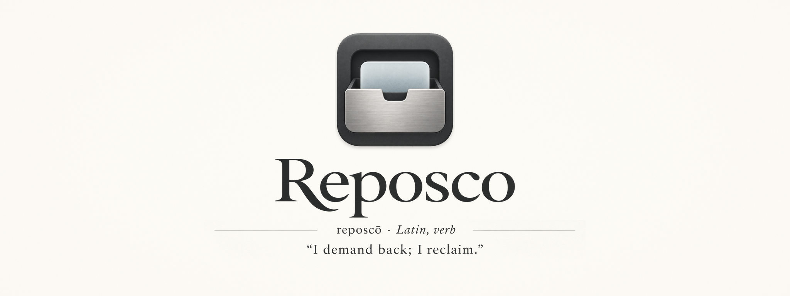
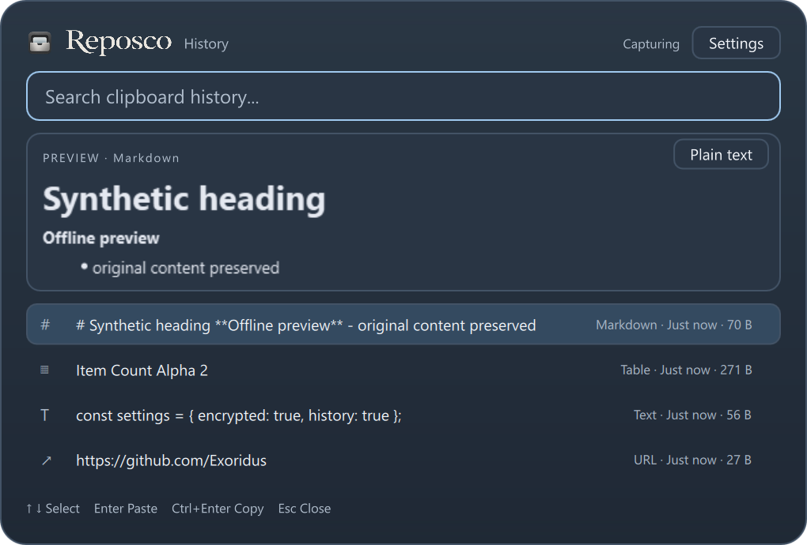

*reposcō · Latin, verb*
“I demand back; I reclaim.”

Reposco is an offline clipboard manager for Windows, built with C++20 and Qt Quick.
It keeps a searchable, encrypted local history and brings selected content back to
your application through a compact keyboard-oriented palette.

**Development preview.** No stable release or independent security audit has been
published. The current implementation supports bounded text and rich-content
formats; it does not preserve every Windows clipboard format.

## What works today

- Explicit opt-in capture, persistent pause/resume and smart deduplication.
- SQLCipher-encrypted history with a random key protected by Windows DPAPI.
- Unicode text, supported HTML/RTF and PNG/DIB images, with original-format replay.
- Search, bounded offline Markdown/image/table previews and a plain-text fallback.
- Configurable native application exclusions, exact-code filters and retention.
- A global shortcut, keyboard selection, separate Settings and a tray menu.



Actual Qt Quick window at 150% application scaling, populated with synthetic test
data. This demonstrates the interface, not a password-manager compatibility test.

## Install and run

There is no official download or installer release yet. Build from source using
the instructions below, then launch the visible palette:

```powershell
./build/windows-debug/reposco.exe --show
```

Open **Settings** and choose **Enable / resume capture** to opt in. First launch
starts paused. Closing the palette leaves the tray process running; use the tray
menu to open it, pause capture or quit. Resume does not import the current clipboard.

For a locally staged portable build, run `./build/package-stage/reposco.exe --show`
after packaging. `--smoke --show` uses temporary storage with capture disabled.

## Keyboard shortcuts

| Shortcut | Action |
| --- | --- |
| Win+Alt+V | Open the palette, when registration succeeds |
| Up / Down | Select a history entry |
| Enter | Restore supported original formats and request paste |
| Shift+Enter | Restore plain text and request paste |
| Ctrl+Enter | Copy supported original formats without pasting |
| Escape | Hide the palette |

Type to search. Image-only entries have no plain-text replay. If the target loses
focus, is elevated or unavailable, or the clipboard is busy, automatic paste can
be cancelled; copy and manual paste remain the fallback. Dispatching paste input
does not guarantee that every destination application accepts it.

## Privacy and local storage

Reposco has no telemetry, account, sync or automatic updater. Previews do not load
web, local-file, UNC or embedded markup resources; copied URLs are never fetched.

Recognized Windows exclusion markers are checked before payload reads. After
trimming surrounding whitespace, standalone six-digit ASCII codes are excluded
from persistent history by default, before hashing or indexing. This can also skip
legitimate numbers; the filter is switchable. Eight-digit exclusion is optional.
Capture filters leave the Windows clipboard unchanged.

**Unmarked secrets can still be captured.** Browser clipboard writes cannot
reliably be attributed to a particular password-manager extension. Native
application exclusions use full executable paths. Pause capture before copying
unmarked sensitive content. Encryption at rest is not a guarantee of safe capture.

`history.db`, the DPAPI-protected `key.dat` and non-content `settings.ini` live in
the Windows per-user application data directory. History is capped at 1000 items
and 1 GiB of logical payload, with selectable 7/30/90-day retention. Physical
database size can remain larger. Confirmed **Clear history** pauses capture and
deletes entries logically; it does not promise forensic SSD erasure. Changing
filters does not retroactively remove existing entries. Losing the key can make
history unrecoverable.

See [Privacy](PRIVACY.md) and the [threat model](docs/security/threat-model.md).

## Development status

Windows x64 is the supported desktop target. Linux/macOS currently exercise only
the portable core. Rich formats use conservative size and structure limits;
arbitrary formats, pinning, sync and recovery/export are unavailable. Native
backdrop blur is not implemented; the palette uses a legible solid fallback.
Password-manager compatibility, third-party rich paste destinations and broader
multi-monitor/DPI behavior still need hands-on validation.

The latest capture/replay scope and actual checks are documented in
[rich-content validation](docs/development/rich-content-validation.md) and
[UI/security validation](docs/development/ui-security-recovery-validation.md).

## Build from source

Requires Windows 11 x64, MSVC x64 tools, Ninja, CMake >=3.27 and Qt **6.12.0**
(`msvc2022_64`). Install the Qt SDK separately; an existing installation is reused.
Pass `-QtRoot <SDK path>` if discovery cannot find it.

```powershell
git clone --branch bootstrap https://github.com/Exoridus/reposco.git
cd reposco
./tools/dev.ps1 setup
./tools/dev.ps1 build
./tools/dev.ps1 test
./build/windows-debug/reposco.exe --show
```

Local builds default to **six jobs**; `-BuildJobs` overrides the local limit.
CI uses all available logical processors. Debug and Release outputs and caches
remain separate. To stage a development portable package:

```powershell
./tools/dev.ps1 build -Configuration Release
./tools/package.ps1
```

The Qt-free core uses `cmake --preset portable`, `cmake --build --preset portable`
and `ctest --preset portable`. See [build and test](docs/development/build-and-test.md)
for setup, focused tests and optional sccache support.

## Contributing and security

Bug reports and focused contributions are welcome. Start with
[Contributing](CONTRIBUTING.md), [architecture](docs/architecture/overview.md) and
[code quality](docs/development/code-quality.md). Use synthetic examples; never
attach clipboard databases, keys, credentials or unsanitized crash dumps.

Report vulnerabilities privately as described in [Security](SECURITY.md), rather
than in public issues.

## License and acknowledgments

Reposco is licensed under [GPL-3.0-or-later](LICENSE). It uses Qt, QWindowKit,
SQLCipher, SQLite and OpenSSL; exact revisions and redistribution notices are in
[third-party notices](THIRD_PARTY_NOTICES.md) and the
[dependency manifest](third_party/deps.lock.json).

The supplied Reposco icon, original wordmark and banner are raster artwork. No
replacement fonts or generated vector assets are bundled.
