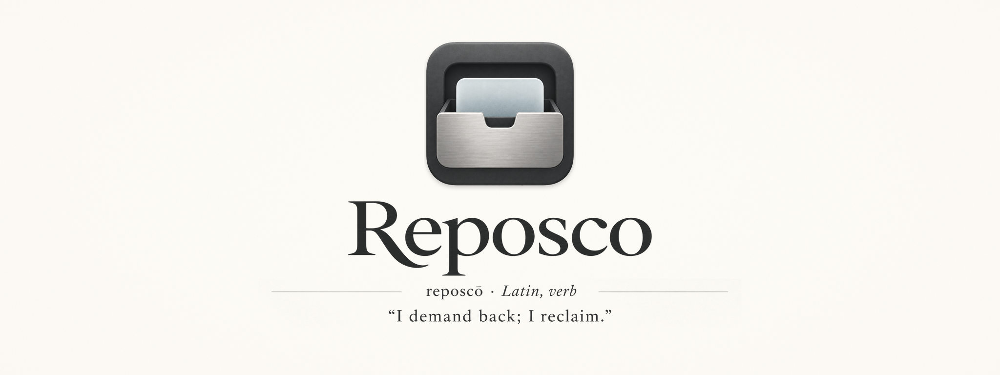

# Reposco



An offline, privacy-oriented clipboard manager for Windows, built with C++20 and Qt Quick.

**Status: 0.1.0-dev experimental rich-history slice.** The executable provides opt-in Unicode text capture, SQLCipher-encrypted local history, a random DPAPI-protected key, Smart dedup, Pause/Resume and a compact keyboard-oriented history palette. Search, bounded offline Markdown/image/table previews and separate Settings are available. First launch is paused; consent and pause persist, and resuming never imports the existing clipboard. Supported Unicode text, HTML, RTF and PNG/DIB image representations are preserved for original-format copy/replay; pinning and arbitrary clipboard formats remain unavailable.

```powershell
git clone https://github.com/Exoridus/reposco.git
cd reposco
./tools/dev.ps1 setup
./tools/dev.ps1 build
./tools/dev.ps1 test
./tools/dev.ps1 run
```

Requires Windows x64, MSVC 2022 or a compatible newer compiler, Ninja, CMake >=3.27 and Qt **6.12.0**. Existing Qt installations are reused; pass `-QtRoot` to override. Local builds default to six parallel jobs; CI uses all available logical processors. Use the tray to show, open Settings, pause or quit. Closing the palette keeps the tray process alive.

Open Settings and select **Enable / resume capture** to opt in. Recognized exclusion markers are checked before payload reads. Exact six-digit ASCII codes are excluded by default before hashing or storage; this can also skip legitimate numbers and can be disabled. Exact eight-digit exclusion is optional. Filtering never alters the Windows clipboard. Unmarked passwords cannot reliably be recognized; browser-extension writes cannot reliably be attributed to a particular extension. Native application exclusions use full executable paths.

History is limited to 1000 items and 1 GiB of logical payload, with a selectable 7/30/90-day retention limit. The palette shows at most 100 bounded summaries, four visible slots and an 8192-character plain-text fallback alongside bounded rich previews. Search is literal, with ASCII case folding. Settings provides confirmed Clear history; it pauses capture and deletes encrypted history logically, without promising forensic SSD erasure. Missing keys or unsupported/corrupt history lock capture without replacing original files.

For a visible launch after building, run `./build/windows-debug/reposco.exe --show`. `--diagnostics` enables payload-free lifecycle messages. `--smoke --show` uses temporary storage, disables capture and exits automatically. Up/Down selects entries; Escape hides the palette. Enter offers supported original formats to the previous eligible application, Shift+Enter offers plain text, and Ctrl+Enter copies original formats without pasting. Image-only entries have no plain-text replay. Replay reads the full original rather than the preview. Own writes carry exclusion markers and do not create capture loops. Focus changes, unavailable/elevated targets or clipboard contention cancel automatic paste with an explanatory status; copy/manual paste remains the fallback. Successful input dispatch is not proof that every destination accepts paste. The default hotkey is Win+Alt+V; alternative hotkeys, light/dark appearance and reduced motion are session settings. The rounded glass appearance uses a legible solid fallback; native backdrop blur is not claimed.

Portable core builds without Qt: `cmake --preset portable`, `cmake --build --preset portable`, `ctest --preset portable`. Linux/macOS desktop integration is not supported yet.

[Build and test](docs/development/build-and-test.md) | [Code quality](docs/development/code-quality.md) | [Text-history validation](docs/development/text-history-validation.md) | [UI/security validation](docs/development/ui-security-recovery-validation.md) | [Rich-content validation](docs/development/rich-content-validation.md) | [Architecture](docs/architecture/overview.md) | [Privacy](PRIVACY.md) | [Security](SECURITY.md) | [Contributing](CONTRIBUTING.md)

GPL-3.0-or-later. See [LICENSE](LICENSE) and [third-party notices](THIRD_PARTY_NOTICES.md). No release has been published.
